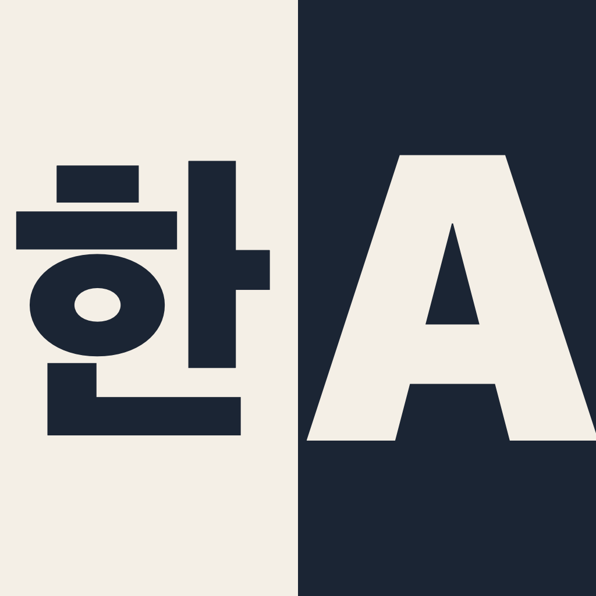

# KoEnFix

macOS 메뉴바 앱입니다. 한글 두벌식과 영문(ABC) 입력기를 잘못 둔 채로 친 단어를 `Space` 또는 `Shift + Space`로 고치고, 입력기도 함께 바꿉니다. 키보드 입력은 이 Mac 안에서만 처리하며 네트워크로 보내지 않습니다.



macOS 13 이상이 필요하고, 한글 입력기는 두벌식입니다.

## 예시

| 입력기 | 친 글자 | 키 | 결과 |
| --- | --- | --- | --- |
| 한글 | `스ㅕㅌ` | `Space` | `tmux`, 입력기는 ABC |
| 한글 | `ㅣㄴ`, `치명ㄷ`, `햣` | `Space` | `ls`, `claude`, `git` |
| 영문, 적극 모드 | `dkssud`, `djeltj`, `durl` | `Space` | `안녕`, `어디서`, `여기` |
| 영문 | `dkssud` | `Shift + Space` | `안녕`, 다음 `Space`부터도 변환 |
| 한글, 조합이 끝난 단어 | `안녕` | `Shift + Space` | `안녕` 그대로 |

[5초 데모](Resources/koenfix-demo.mp4)는 `스ㅕㅌ` → `tmux`입니다. [사용 영상](Resources/koenfix-usage.mp4)은 적극 모드에서 명령어 교정, `djeltj` → `어디서`, 그리고 목록에 넣었다가 빼는 과정까지 보여 줍니다.

## 설치

```bash
git clone https://github.com/s1ckdark/KoEnFix.git
cd KoEnFix
./scripts/setup-koen-fix.sh --install
```

앱은 `/Applications/KoEnFix.app`에 설치되고 로그인 시 메뉴바로 실행됩니다. 설치가 끝나면 **시스템 설정 → 개인정보 보호 및 보안 → 손쉬운 사용**에서 KoEnFix를 켜세요. 권한이 없으면 메뉴바 아이콘에 주황 점이 붙고, 메뉴에서 설정 화면을 열 수 있습니다.

설치 스크립트는 앱을 ad-hoc 서명합니다. 다시 설치하면 macOS가 새 서명으로 보아 손쉬운 사용 허용이 풀릴 수 있습니다. 그때는 KoEnFix를 껐다가 다시 켜세요. 서명만 바뀐 뒤에는 `--install`로 다시 등록하세요.

```bash
./scripts/setup-koen-fix.sh --status      # 실행 여부
./scripts/setup-koen-fix.sh --test        # 자체 테스트
./scripts/setup-koen-fix.sh --restart     # 같은 서명으로 재시작
./scripts/setup-koen-fix.sh --uninstall   # LaunchAgent와 앱 삭제
```

로그는 `/tmp/koen-fix.log`, `/tmp/koen-fix.err`에 남습니다.

## 메뉴

메뉴바 아이콘을 누르면 다음을 고를 수 있습니다.

- **활성화**: 끄면 키를 그대로 통과시킵니다. 자동 변환과 `Shift + Space` 교정은 하지 않습니다.
- **보수적 자동 변환**: 처음 설치했을 때의 모드입니다. 한글 모드의 깨진 자모와 명령어만 `Space`로 영문이 됩니다.
- **적극적 자동 변환**: 보수적 변환에 더해, 영문 모드에서 친 한글도 `Space`로 바꿉니다. 아래 목록도 이 모드에서만 적용됩니다.
- **수동 변환 전용**: `Space` 자동 변환 없이 `Shift + Space`만 사용합니다.
- **터미널에서 Enter 시 명령어 교정**: 앞에 있는 앱이 Terminal, iTerm2, Ghostty, WezTerm, kitty, Alacritty, Warp, Hyper일 때 동작합니다.

## Space

한글 모드에서 자모가 깨진 채 친 명령어는 `Space`로 영문이 되고 입력기는 ABC가 됩니다. `스ㅕㅌ` → `tmux`, `ㅣㄴ` → `ls`, `치명ㄷ` → `claude`, `햣` → `git`, `쳐기` → `curl`, `녀애` → `sudo`, `-ㅣㅁ` → `-la`가 이 경우입니다. `ㅋㅋㅋ`, `ㅎㅎ`, `ㅠㅠ`, `ㅜㅜ`, `ㅇㅇ`, `ㄱㅅ`와 `해`, `내`처럼 이미 말이 되는 짧은 한글은 그대로 둡니다.

적극 모드에서는 영문으로 친 한글도 `Space`로 바뀌고 입력기는 두벌식이 됩니다.

- `dkssud` → `안녕`, `gksrmf` → `한글`, `dkssudgktpdy` → `안녕하세요`
- `djeltj` → `어디서`, `djel` → `어디`, `anjdi` → `뭐야`, `rmfotj` → `그래서`
- `durl` → `여기`, `rmsep` → `근데`, `sodlf` → `내일`

`work`, `girl`, `curl`, `forms`, `django`처럼 영어 단어로 읽히는 문자열은 목록에 넣기 전에는 바꾸지 않습니다. 보수 모드와 수동 모드는 영문 → 한글 자동 변환을 하지 않습니다.

터미널에서 `ㅣㄴ`, `스ㅕㅌ`, `햣`, `:ㅂ`(`:q`), `:ㅈㅂ`(`:wq`)를 치고 `Enter`를 누르면, 그 명령이 실행되기 전에 영문으로 고칩니다.

## Shift + Space

입력 중인 단어가 있으면 바로 고칩니다.

- 자모가 깨진 한글(`스ㅕㅌ`, `ㅣㄴ`, `치명ㄷ`)은 영문이 되고 입력기는 ABC가 됩니다.
- 영문(`dkssud`)은 한글(`안녕`)이 되고 입력기는 두벌식이 됩니다. 이 키 입력은 목록의 **Space로 바꿀 영문**에 들어가, 적극 모드에서는 다음부터 `Space`만으로도 바뀝니다.
- 음절이 끝난 한글(`안녕`, `한글`, `해`)은 영문으로 되돌리지 않습니다. 아직 그 단어를 치는 중이면 키만 삼키고 입력을 이어 갑니다. `Space`로 확정한 직후면 글자는 두고 입력기만 토글합니다.

치고 있는 단어가 없으면 `Shift + Space`는 한/영 입력기를 토글합니다.

## 목록

적극 모드의 영문 → 한글 변환만 목록을 봅니다. 키 입력을 그대로 기억하므로 `q`와 `Q`는 다른 항목입니다. 두 목록은 한 문자열을 함께 담지 않고, 각각 최근 항목부터 200개까지 저장합니다. 메뉴에는 8개까지 보입니다.

- **Space로 바꿀 영문**: 영문에서 `Shift + Space`로 한글로 바꾼 문자열입니다. 다음 `Space`부터 바뀝니다. `work`도 한 번 이렇게 바꾸면 이후에는 `재가`가 됩니다.
- **그대로 둘 영문**: `Space`로 바뀐 한글과 뒤의 공백을, 다른 키 없이 백스페이스로 바로 모두 지운 문자열입니다. 다음부터 그 영문은 그대로 둡니다. 글자 일부만 지우면 목록에 들어가지 않습니다.
- **학습 목록 비우기**: 두 목록을 모두 지웁니다.

자동으로 잘 바뀐 단어는 목록에 넣지 않습니다. 직접 고친 경우만 기록합니다.

## 영상과 아이콘 다시 만들기

영상 스크립트는 [ffmpeg](https://ffmpeg.org/)가 `/opt/homebrew/bin/ffmpeg`에 있어야 합니다.

```bash
swift scripts/render-demo.swift       # Resources/koenfix-demo.mp4
swift scripts/render-usage.swift      # Resources/koenfix-usage.mp4
swift scripts/render-app-icon.swift   # Resources/AppIcon.icns
```

프레임은 모델이 아니라 Swift로 그려서, 영상에 나오는 한글과 영문이 앱의 변환 결과와 같습니다.
